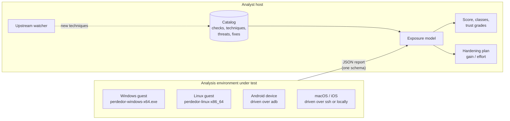
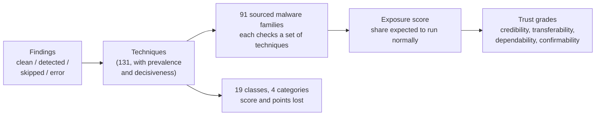

<p align="center">
  
</p>

<h1 align="center">PERDEDOR</h1>

<p align="center">
  <b>Sandbox-evasion self-test for Windows, Linux, Android, macOS and iOS.</b><br>
  Finds every tell evasive malware could use to notice your sandbox, scores what it costs you,
  and tells you what to fix first.
</p>

<p align="center">
  <a href="https://github.com/Chimera-Co/perdedor/actions/workflows/ci.yml"></a>
  <a href="https://chimera-co.github.io/perdedor/"></a>
  <a href="LICENSE"></a>
</p>

Malware that notices it is being analysed stops, sleeps or behaves. Over 40 % of Windows samples
collected in 2020 checked for that before doing anything
([Maffia et al.](https://arxiv.org/abs/2112.11289)). Perdedor runs those same checks against your
analysis environment, so you see what the malware would see before it does.

- **1,009 checks on five platforms**, covering al-khaser, Pafish, VMAware, InviZzzible and the
  mobile RASP suites, with every upstream technique mapped and the gaps stated.
- **One score that means something:** the share of known evasive malware expected to run normally
  in your environment, with an interval, per-class detail and a trust grade.
- **A fix order:** every detection comes with how to fix it, at which layer and with what effort,
  ordered by score gained per unit of work.
- **Who uses each tell:** 91 malware families, tools and actors mapped to the techniques they check.
- **Kept current:** a weekly job watches 30 upstream projects and opens an issue when they add a
  technique Perdedor does not test yet.

## How it works



Every agent emits the same report. The catalog ties each check to a technique, each technique to the
malware that uses it, and each detection to a fix. The exposure model turns a report into a score and a
plan.

## Platforms

| Platform | Checks | Agent | Runs |
|---|---|---|---|
| Windows, x64 and x86 | 432 | Native C++17, statically linked (`perdedor-windows-x64.exe`, `-x86.exe`) | Inside the guest. No PowerShell, .NET or runtime needed. Builds for Windows 7 and later; tested on Windows 10, 11 and Server 2022/2025. |
| Linux x86-64 | 191 | Native C++17, static (`perdedor-linux-x86_64`) | Inside the guest. Also runs on Android-x86. |
| Android | 197 | Python driver over adb | From the analyst host. Nothing is installed on the device; the native binary is pushed only for CPU and timing probes on x86 devices. |
| macOS | 116 | Python driver | Locally, or from the analyst host over ssh. |
| iOS | 73 | Python driver | Over ssh (jailbroken or Corellium device) or against the Simulator. |

## Quick start

Download the agents from the [latest release](https://github.com/Chimera-Co/perdedor/releases)
(each file has a signed build attestation), or build them: `make -C native` needs `g++` and
MinGW-w64.

**Windows guest.** Copy the executable in and run it. The report is plain JSON:

```bat
perdedor-windows-x64.exe --profile standard -o report.json
```

**Linux guest.**

```bash
./perdedor-linux-x86_64 --profile standard -o report.json
```

**Analyst host** (Python 3.10 or newer): install the CLI, then score the report, or let the CLI run an
agent for you.

```bash
pip install perdedor-2.0.0-py3-none-any.whl     # or: pip install -e . from a checkout

perdedor score report.json                      # exposure score with per-class detail
perdedor plan report.json                       # what to fix first

perdedor test linux --profile deep              # run the native agent on this host and score it
perdedor test android -s emulator-5554          # an adb-attached device or emulator
perdedor test macos -- --ssh analyst@mac-vm     # arguments after -- go to the macOS/iOS agent
perdedor test ios -- --simulator booted
```

### Choosing what runs

The same selectors work in every agent, in `perdedor test` and in the CHIMERA console.

| Option | Meaning |
|---|---|
| `--profile quick\|standard\|deep` | Cheap checks only, the default set, or everything including slow probes |
| `--only PATTERN…` / `--skip PATTERN…` | Id globs (`win.timing.*`) or `class:`, `category:`, `technique:`, `cost:`, `tag:` selectors |
| `--param KEY=VALUE` | Tune a threshold, for example the minimum disk size |
| `--no-network` | Leave out every check that sends traffic |
| `--list-checks` | Print the catalog for this platform and exit |

Checks that need a human at the keyboard (mouse movement, clicks) carry the `interactive` tag and only
run when selected.

## Example

The Windows agent run under Wine on a Linux laptop: an environment that is plainly not Windows, so
the score should be low, and it is.

```text
$ perdedor score wine-report.json
Perdedor exposure score (windows): 21.1/100  [FAIL]
  Share of known evasive malware expected to see no sign of analysis here and run normally.
  90 % interval 10.3-32.9; coverage 92% (88/104 techniques tested, 32 detected)
  threat model: catalog/threats.json (91 families)

Classes                                    score  lost  tested/all det
  CPU and instruction set                  49.5  34.6   10/10    3  ##########..........
  Registry, files and named objects        75.8  13.7    5/5     1  ###############.....
  Human interaction                        82.5   9.5    2/4     2  #################...
  Wear and tear                            89.8   5.3   11/11   11  ##################..
  ...

$ perdedor plan wine-report.json
Hardening roadmap (windows): 21.1 -> 72.9 if every step is applied
 #  gain  after  effort  layer            technique
 1   6.7   27.8       1  guest-image      artifacts.registry - Registry keys/values left by virtualisation software
 2  10.3   38.1       4  analysis-engine  cpu.hypervisor_vendor_leaf - CPUID 0x40000000 hypervisor vendor signature
 3  13.4   51.5       4  analysis-engine  cpu.hypervisor_bit - CPUID leaf 1 ECX bit 31 (hypervisor present)
 ...
```

## The score



- **Headline:** the expected share of known evasive malware that sees no sign of analysis and runs
  normally, 0–100. A single decisive tell such as the CPUID hypervisor bit costs about 28 points;
  ten minor ones cost little. Adding trivial clean checks cannot raise it.
- **Honest about gaps:** errors and skips are never counted as clean. Techniques that were not tested
  are estimated from those that were, and the interval widens to show it.
- **Chosen, not assumed:** seven candidate formulas (nine variants) were tested against eleven requirements on
  synthetic data and on labelled hardening experiments of a real Xen sandbox. The lab is in
  `research/scoring-lab/`; the reasoning is in [docs/SCORING.md](docs/SCORING.md).

## Staying current

`perdedor upstream check` compares each tracked project (al-khaser, Pafish, VMAware, the Check Point
Evasions encyclopedia, capa and CAPE rules, ATT&CK, MBC, the Android and iOS RASP suites, DRAKVUF,
Xen, QEMU and more) with the revision Perdedor last reviewed, and lists new techniques that no check
covers. The [upstream-watch workflow](.github/workflows/upstream-watch.yml) runs it every Monday and
keeps one issue open with the result. `perdedor coverage` prints how much of each project is covered.

## Using it with CHIMERA

Perdedor was built for [CHIMERA](https://github.com/Chimera-Co/chimera), a Xen and DRAKVUF malware
sandbox. CHIMERA's console runs Perdedor inside a fresh guest, with or without DRAKVUF attached, shows
the exposure score, class breakdown and hardening plan, and lets the operator pick checks with the same
selectors. Perdedor itself does not depend on CHIMERA and works against any sandbox.

## Documentation

The full documentation is at **[chimera-co.github.io/perdedor](https://chimera-co.github.io/perdedor/)**.

| Page | What it covers |
|---|---|
| [Architecture](docs/ARCHITECTURE.md) | Components, data model, how a scan runs |
| [Scoring](docs/SCORING.md) | The exposure model, how it was chosen, how to read it |
| [Threats](docs/THREATS.md) | Which malware checks what, with sources |
| [Check coverage](docs/CHECK_COVERAGE.md) | Every upstream technique: covered, planned, not feasible or missing |
| [Upstream](docs/UPSTREAM.md) | The watcher and how to turn an update into checks |
| [Landscape](docs/LANDSCAPE.md) | Other tools, research and patents, and how Perdedor compares |
| [Design and contributing](docs/DESIGN-V2.md) | Catalog format, id rules, safety rules for probes, tests |
| Platform notes | [Windows](docs/notes/windows.md), [Linux](docs/notes/linux.md), [low-level](docs/notes/lowlevel.md), [Android](docs/notes/android.md), [Apple](docs/notes/apple.md) |

## Building and testing

```bash
python3 -m venv .venv && . .venv/bin/activate
pip install -e ".[dev]"
make -C native            # Linux agent, both Windows agents
make -C native test       # native unit tests (parsers, SMBIOS/ACPI/EDID, timing statistics)
pytest -q                 # Python agents, catalog consistency, scoring, CLI
```

CI builds every agent and runs it for real on Windows Server 2022 and 2025 (x64, and 32-bit under
WOW64), Linux and macOS, validates each report against the schema and the catalog, and runs CodeQL.
Tagged releases publish the agents and Python packages with signed provenance attestations.

## Safety

Perdedor only reads. It installs nothing and changes no settings. Probes that could crash or hang a
guest (some VMAware and al-khaser instruction tricks) are not implemented and are listed as not
feasible. Network checks can be switched off with `--no-network`. It is a test tool for sandbox
operators and contains no malware.

## Licence

MIT. See [LICENSE](LICENSE).
