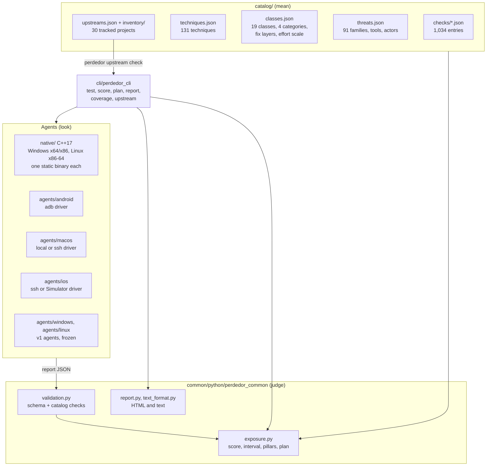
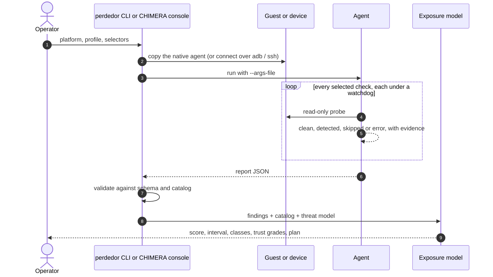

# Architecture

Perdedor has three parts: **agents** that look at an environment, a **catalog** that says what each
finding means, and an **assessment** layer that turns findings into a score and a plan. They meet in
one JSON report format, so a finding from a Windows guest, an Android phone and a macOS VM can be read,
scored and compared the same way.

- [Components](#components)
- [Data model](#data-model)
- [How a scan runs](#how-a-scan-runs)
- [Running inside CHIMERA](#running-inside-chimera)
- [Design decisions](#design-decisions)

## Components



| Path | Role |
|---|---|
| `native/src/core/` | Check registry, selection (`--profile`, `--only`, `--skip`, `--param`), per-check watchdog, JSON writer, command line |
| `native/src/common/` | Checks compiled into both native builds: CPUID, RDTSC and other instruction and timing probes |
| `native/src/windows/` | Windows checks: SMBIOS, ACPI, EDID, registry, WMI, devices, wear and tear, identity, network, low-level debugger and instrumentation probes |
| `native/src/linux/` | Linux checks: DMI, `/proc` and `/sys`, containers, systemd-detect-virt parity, low-level probes |
| `agents/android/` | Host-side adb driver; pushes the static Linux binary to x86 devices for CPU and timing probes |
| `agents/macos/`, `agents/ios/` | Host-side drivers over ssh, locally (macOS) or against the Simulator (iOS) |
| `agents/windows/`, `agents/linux/` | The v1 PowerShell and Python agents, kept as a fallback (`--engine legacy`), no new checks |
| `catalog/` | Everything that gives a finding meaning; see the data model below |
| `common/python/perdedor_common/` | Models, catalog loader, registry for the Python agents, validation, exposure model, renderers |
| `cli/perdedor_cli/` | The `perdedor` command |
| `schema/perdedor-report.schema.json` | The report format every agent emits |
| `research/` | The scoring lab, prevalence data and proposed new techniques |

## Data model

```mermaid
erDiagram
    CHECK }o--|| TECHNIQUE : "implements one"
    TECHNIQUE }o--|| CLASS : "belongs to"
    CLASS }o--|| CATEGORY : "rolls up to"
    FAMILY }o--o{ TECHNIQUE : "uses (sourced)"
    CHECK ||--o{ EQUIVALENT : "maps to upstream"
    CHECK ||--|| FIX : "has"
    FINDING }o--|| CHECK : "is a result of"
    CHECK {
        string id "win.env.cpuid_hypervisor_bit"
        string status "implemented, planned, not_feasible"
        string severity
        string cost "fast, medium, slow"
        bool network
    }
    TECHNIQUE {
        string key "cpu.hypervisor_bit"
        float discrimination
        string prevalence_tier
        string attack "T1497.001"
    }
    FIX {
        string layer "guest-image to host-hardware"
        int effort "1 to 5"
        string how
    }
    FINDING {
        string status "clean, detected, skipped, error"
        object evidence
        float confidence
    }
```

- A **check** is one concrete probe on one platform (`win.env.cpuid_hypervisor_bit`). Ids never change
  once released.
- A **technique** is the platform-independent idea (`cpu.hypervisor_bit`). Several checks on several
  platforms can implement one technique; the score works on techniques, so adding a second check for
  the same idea cannot inflate it.
- A **class** groups techniques (CPU, firmware, wear and tear…). **Categories** group classes into the
  four families used throughout CHIMERA: environment artifacts, timing, behaviour and interaction, and
  design-specific.
- A **family** (malware family, tool or actor) lists the techniques it is documented to check, with
  sources. That is what lets the score say how many known evasive families would still run here.
- An **equivalent** names the upstream function or technique a check covers, spelt exactly as upstream
  spells it; `perdedor coverage` counts these.
- A **fix** says where the problem lives (one of eight layers, from `guest-runtime` to
  `host-hardware`), how hard it is (1 = minutes in the guest, 5 = architectural) and how to do it.

## How a scan runs



Unknown is never clean. A probe that could not look (access denied, API missing, timeout) reports
`error` or `skipped` with the reason, and the model leaves it out instead of counting it as a pass.

## Running inside CHIMERA

CHIMERA (Xen 4.19 with DRAKVUF) runs Perdedor as one of its evasion verifiers:

1. A disposable copy of the golden image is restored, optionally with DRAKVUF attached so its CPUID
   masking and simulated input are active, exactly as during a real detonation.
2. The native agent and an argument file built from the operator's choices are copied in and started
   through the guest shell.
3. The report comes back, is validated, and is scored together with any other tools that ran (Pafish,
   al-khaser, VMAware, a CPUID timing probe). Their findings are mapped onto the same techniques, so
   they add evidence rather than a second, incompatible number.
4. The console shows the exposure score, the class and category breakdown, the detected techniques with
   the families that use them, and the hardening plan.

The guest is destroyed afterwards. Nothing Perdedor does persists into the image used for detonation.

## Design decisions

- **Native agents for Windows and Linux.** Malware probes the machine natively. A test suite that needs
  PowerShell 7 or Python in the guest tests a machine that does not look like a victim, misses
  low-level tells (instruction timing, exceptions, raw firmware tables, `ntdll`) and cannot run on
  minimal images. One static binary per target has no runtime dependencies.
- **Host-side drivers for phones and Macs.** Installing an app on a phone changes the phone. The
  Android, iOS and macOS drivers look from outside over adb or ssh; the only thing ever copied is the
  native Linux binary to x86 Android devices, removed again after the run.
- **Read-only, bounded, never crashing.** Every probe is read-only and runs under a watchdog with a
  budget set by its cost class. Techniques known to crash guests (for example VMAware's `EIP_OVERFLOW`
  on Xen) are catalogued as not feasible rather than implemented.
- **The catalog is data.** Checks, techniques, threats, fixes and upstream mappings live in JSON, so they
  can be reviewed, diffed and extended without touching agent code, and the console, the CLI and the
  documentation all read the same source.
- **The score is a model, not a count.** See [SCORING.md](SCORING.md) for why a pass rate or a points
  total misleads, and how the exposure model was chosen.
