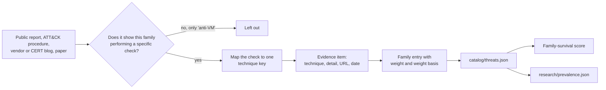
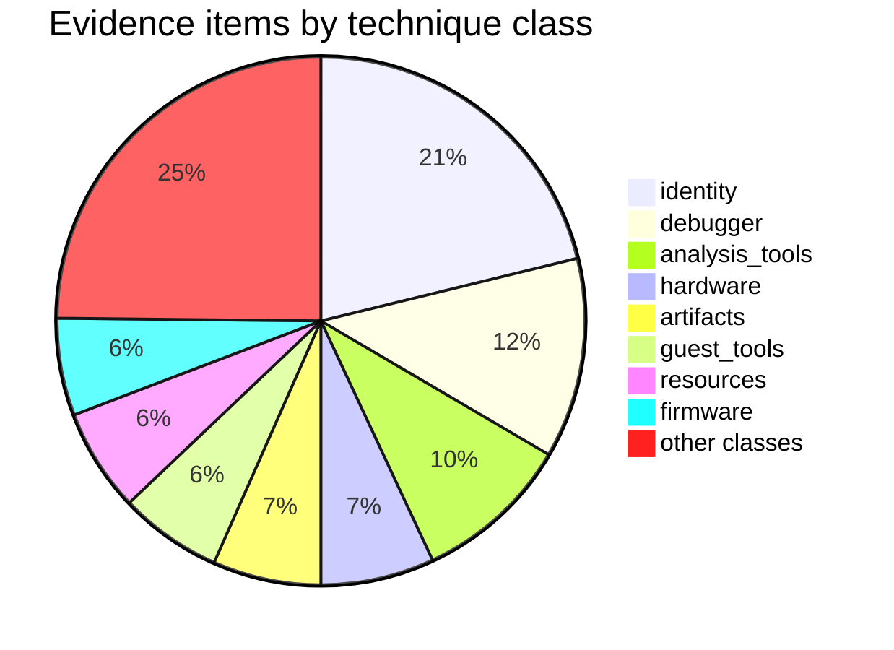

# Threat model: which malware checks what

`catalog/threats.json` lists 120 malware families, tools and campaigns, each with the
environment checks that public reporting shows it performing, mapped to Perdedor
technique keys. The exposure score uses it once a platform has at least 10 sourced
families (`MIN_SOURCED_FAMILIES` in `exposure.py`): the score then becomes the
weighted share of these families that would not detect the tested environment.
`research/prevalence.json` holds a per-technique prevalence estimate for the
tier-based form and for the planner.

| Platform | Families | Families with weight >= 1.5 |
|---|---:|---:|
| Windows | 91 | 12 |
| Linux | 11 | 1 |
| macOS | 9 | 1 |
| Android | 13 | 1 |
| iOS | 0 | 0 |

302 evidence items from 75 distinct sources; 75 of the 131 technique keys are used.

## Method

1. **Inclusion.** A technique is listed for a family only when a cited source shows that
   family, or the loader or crypter it ships inside, performing that check. Reports
   that only say "it has anti-emulator checks" (SharkBot's Cleafy report, Rotexy's
   emulator test, many ATT&CK mobile procedures) do not produce a technique.
2. **Sources.** Vendor research blogs and whitepapers, CERT reports, conference papers,
   published source code (Mirai, AsyncRAT) and MITRE ATT&CK procedure examples for
   T1497, T1497.001-.003, T1622, T1480, T1480.001, T1633, T1633.001, T1518.001 and
   T1614.001. Where an ATT&CK procedure is the source, the URL is the technique page
   and the detail names the software ID and the reference it cites, for example
   "(ATT&CK S0547, citing Cybereason, 2020)"; `published` is the date of that reference.
   Dates are `YYYY`, `YYYY-MM` or `YYYY-MM-DD`, or `null` when the page is undated.
3. **Mapping rules** used where the vocabulary leaves room:
   * Language, keyboard, GeoID, SIM-country and time-zone guards map to
     `identity.locale`, whether they exclude CIS countries or require a target country.
   * Only measured sleeps map to `timing.sleep_acceleration`; plain delays and
     dormancy are not mapped (see the proposals file).
   * RDTSC around CPUID maps to `timing.cpuid_vmexit`; Locky's RDTSC ratio test to
     `timing.rdtsc_api_ratio`.
   * Hosting/datacenter lookups (ip-api `hosting`, Google IP ranges) map to
     `network.public_ip_reputation`; kill-switch domains and Necurs' random-domain
     test to `network.dns_sinkhole`.
   * Defender emulator names (JohnDoe, HAL9TH) map to `identity.username` /
     `identity.hostname`; decoy files planted by sandboxes and honeypots to
     `artifacts.files`.
   * Motion and step-count gates map to `mobile_device.sensor_activity`; sensor
     inventories to `mobile_device.sensors`.
4. **Weights** (0.2-3.0) are relative within a platform and each entry states its basis:

   | Weight | Rule | Source |
   |---|---|---|
   | 3.0 | Top two of ANY.RUN's 2025 annual family counts (Lumma 31,111; XWorm 31,093) | [ANY.RUN 2025](https://any.run/cybersecurity-blog/malware-trends-2025/) |
   | 2.4-2.5 | Over 14,000 ANY.RUN 2025 detections (AsyncRAT, Remcos, Agent Tesla) | same |
   | 2.0 | Rest of ANY.RUN's 2025 or 2024 top 10 | same, [ANY.RUN 2024](https://any.run/cybersecurity-blog/malware-trends-2024/) |
   | 1.5 | Named as widespread by ANY.RUN, CISA AA22-216A or Europol Operation Endgame | [CISA](https://www.cisa.gov/news-events/cybersecurity-advisories/aa22-216a), [Europol](https://www.europol.europa.eu/media-press/newsroom/news/largest-ever-operation-against-botnets-hits-dropper-malware-ecosystem) |
   | 0.8-1.0 | Mid-tier commodity families with sustained vendor coverage | per entry |
   | 0.2-0.6 | APT tooling, single campaigns, niche or historic families | per entry |

   macOS uses Unit 42's statement that Atomic, Poseidon and Cthulhu are the most
   prevalent macOS stealers ([Unit 42, Feb 2025](https://unit42.paloaltonetworks.com/macos-stealers-growing/)).
   No census of Linux or Android family prevalence was found, so those weights are
   judgement weights anchored on the figure each entry quotes (for example Securelist's
   70,000 Rotexy attacks, Doctor Web's 421 million SpinOk downloads).
5. **Prevalence** (`research/prevalence.json`). For each of the 131 keys, `p` is the
   tier prior from `classes.json` when fewer than three families are sourced, otherwise
   the mean of the prior and the share of sourced families on the key's platforms
   that perform the check. Intervals are half the lowest to twice the highest of those
   figures, and a factor of four either side of the prior when evidence is thin. The
   basis also records the two longitudinal results whose numbers were checked against
   the papers: Chen et al. (DSN 2008), where over 40% of 6,900 Windows samples behaved
   less maliciously under a VM or debugger, and Galloro et al. (Computers & Security
   2022), where evasive techniques appear in 67.8% of 2010 samples rising to about 80%
   by 2019, and PEB processor-count and SIDT checks fell out of use.

## Coverage

### Top techniques by family count

| Technique | Families | Windows | Linux | macOS | Android |
|---|---:|---:|---:|---:|---:|
| `identity.locale` | 41 | 34 | 3 | 4 | 4 |
| `debugger.api_flags` | 17 | 17 | 0 | 0 | 0 |
| `analysis_tools.loaded_modules` | 14 | 14 | 0 | 0 | 0 |
| `analysis_tools.processes` | 13 | 13 | 0 | 0 | 0 |
| `artifacts.files` | 11 | 10 | 1 | 0 | 0 |
| `firmware.smbios_strings` | 11 | 9 | 2 | 0 | 0 |
| `guest_tools.processes` | 11 | 11 | 0 | 0 | 0 |
| `identity.username` | 9 | 9 | 0 | 0 | 0 |
| `identity.sample_path` | 8 | 8 | 0 | 0 | 0 |
| `debugger.tracer` | 8 | 0 | 5 | 3 | 0 |
| `resources.cpu_count` | 7 | 6 | 1 | 2 | 0 |
| `resources.memory_size` | 6 | 6 | 0 | 0 | 0 |
| `hardware.disk_identity` | 6 | 5 | 1 | 0 | 0 |
| `artifacts.registry` | 5 | 5 | 0 | 0 | 0 |
| `guest_tools.drivers_modules` | 4 | 4 | 0 | 0 | 0 |

`identity.locale` leads because ransomware and stealer reports almost always state the
CIS exclusion list, and ATT&CK T1614.001 collects them. It is a strong sandbox tell
only for sandboxes that run every sample with one default locale; the score treats it
like any other check.

### Technique classes by family type

Number of families of each type with at least one check in the class.

| Class | apt-tool | stealer | ransomware | loader | banker | backdoor | botnet | rat | crypter | spyware | miner |
|---|---:|---:|---:|---:|---:|---:|---:|---:|---:|---:|---:|
| analysis_tools | 7 | 4 | 0 | 5 | 1 | 2 | 0 | 3 | 0 | 0 | 1 |
| artifacts | 4 | 2 | 1 | 3 | 1 | 1 | 0 | 2 | 0 | 0 | 0 |
| container | 0 | 0 | 0 | 0 | 0 | 0 | 1 | 0 | 2 | 0 | 0 |
| cpu | 1 | 0 | 0 | 5 | 1 | 0 | 0 | 1 | 0 | 0 | 0 |
| debugger | 3 | 6 | 4 | 6 | 0 | 1 | 3 | 3 | 2 | 0 | 0 |
| emulator | 1 | 3 | 0 | 1 | 2 | 0 | 0 | 1 | 0 | 0 | 0 |
| firmware | 4 | 3 | 0 | 3 | 0 | 0 | 1 | 3 | 1 | 0 | 0 |
| guest_tools | 7 | 2 | 0 | 4 | 0 | 0 | 0 | 0 | 1 | 0 | 1 |
| hardware | 4 | 3 | 0 | 5 | 1 | 0 | 0 | 1 | 0 | 1 | 0 |
| human | 5 | 1 | 1 | 3 | 0 | 0 | 0 | 0 | 0 | 0 | 0 |
| identity | 6 | 12 | 10 | 9 | 7 | 6 | 1 | 0 | 2 | 0 | 1 |
| instrumentation | 0 | 1 | 0 | 2 | 0 | 0 | 0 | 0 | 0 | 1 | 0 |
| integrity | 0 | 0 | 0 | 0 | 2 | 0 | 0 | 0 | 0 | 1 | 0 |
| mobile_device | 0 | 0 | 0 | 0 | 2 | 0 | 0 | 0 | 0 | 1 | 0 |
| network | 1 | 3 | 1 | 4 | 0 | 0 | 1 | 1 | 0 | 0 | 0 |
| os_config | 0 | 0 | 0 | 2 | 0 | 0 | 0 | 0 | 0 | 0 | 0 |
| resources | 4 | 2 | 1 | 4 | 0 | 0 | 0 | 1 | 0 | 0 | 1 |
| timing | 3 | 1 | 2 | 3 | 0 | 0 | 0 | 0 | 0 | 0 | 0 |
| wear_and_tear | 1 | 0 | 0 | 1 | 1 | 0 | 0 | 0 | 0 | 1 | 0 |

Loaders carry the hardware and CPU checks (GuLoader, Raspberry Robin, IcedID,
DarkGate): they are the stage that decides whether to deploy anything. Ransomware
checks little beyond locale and debuggers, since it usually runs after an operator
has already chosen the host.

### By platform

* **Windows:** `identity.locale` (34), `debugger.api_flags` (17), `analysis_tools.loaded_modules` (14), `analysis_tools.processes` (13), `guest_tools.processes` (11), `artifacts.files` (10).
* **Linux:** `debugger.tracer` (5), `identity.locale` (3), `debugger.exception_tricks` (2), `firmware.smbios_strings` (2), `container.container_runtime` (1).
* **macOS:** `identity.locale` (4), `debugger.tracer` (3), `emulator.macos_virtual_model` (3), `resources.cpu_count` (2).
* **Android:** `identity.locale` (4), `integrity.root` (3), `mobile_device.sensor_activity` (2), `integrity.developer_settings` (2), `emulator.android_build_identity` (2).

### Trend over time (by evidence publication date)

| Evidence published | Items | Most frequent classes |
|---|---:|---|
| before 2015 | 3 | wear_and_tear, identity, timing |
| 2015-2019 | 56 | identity 13, analysis_tools 8, firmware 6, artifacts 4 |
| 2020-2022 | 90 | identity 25, debugger 11, guest_tools 10, analysis_tools 9 |
| 2023-2026 | 147 | debugger 22, identity 21, resources 12, analysis_tools 12 |

Six items are undated. The rise after 2022 reflects more reporting as well as more
checking. The shift is towards debugger and resource checks (CPU count, RAM, disk
size, GPU name) and away from older registry and guest-tool lists, matching the
Galloro et al. finding that authors drop checks that stop working.

## Notable cases

* **GuLoader** (loader, 2.0). Times CPUID with RDTSC, reads the hypervisor bit, counts
  top-level windows and needs at least 12, and scans for VM drivers and the QEMU guest
  agent. It is a shellcode downloader whose only job is to decide whether to fetch the
  payload, so it front-loads hardware checks a sandbox cannot fake from user mode.
* **Raspberry Robin** (loader, 1.2). The widest single list in the catalog: 22 checks
  across debugger flags, CPUID vendor leaves, SMBIOS raw tables, monitor EDID, MAC
  vendor, thermal zones and Defender emulator quirks, sourced from Zscaler, HP Wolf
  and ATT&CK.
* **Lumma Stealer** (stealer, 3.0). Waits for mouse movement whose angles look human
  (Outpost24, 2023) and checks GPU names. Being the most-detected family in ANY.RUN's
  2025 counts, it is the single largest weight on Windows.
* **Rhadamanthys** (stealer). Hashes the desktop wallpaper against the Triage default,
  looks for sandbox decoy files, compares user names, reads the MAC address through
  UUIDv1 generation and compares the SMBIOS UUID with known sandbox IDs. The wallpaper
  check is proposed as a new key.
* **SUNBURST** (backdoor). Refuses to run on hosts not joined to an AD domain or joined
  to lab-looking domains, and hashes processes, services and drivers against a
  blocklist. Its checks target real enterprise hosts, which is why it went unnoticed
  for months; a domain-joined sandbox with no security tooling passes it.
* **WannaCry and Necurs** (network). Both exploit sandboxes that answer every DNS
  lookup. WannaCry's single hard-coded domain made the check a global kill switch.
* **Kazuar** (backdoor). Counts decoy files and processes typical of a Kaspersky
  honeypot and only flags one when more than five are present, a deliberately
  tolerant rule against false positives on real hosts.
* **Locky** (ransomware). Compares RDTSC deltas around cheap and trapping calls and
  waits for the foreground window to change several times.
* **Atomic macOS Stealer** (stealer, 3.0 on macOS). Reads `system_profiler` hardware and
  memory data for VMware, QEMU and "Apple Virtual Machine" strings. The memory check
  is on macOS, which `hardware.memory_modules` does not yet list.
* **Mirai and Linux families.** Linux malware mostly checks for a tracer (TracerPid,
  self-ptrace, SIGTRAP handlers) rather than for a VM. Exceptions are Amnesia (DMI
  strings, then wipes the VM), QuimaRAT (DMI, hypervisor flag, guest agents) and
  GorillaBot (exits inside Kubernetes pods).
* **Android bankers.** Anubis and Cerberus wait for real motion or steps; Hydra and
  Anatsa compare `Build` fields with emulator values; Mandrake looks for Frida, root,
  developer options and a configured Google account; SharkBot droppers need a target
  SIM country and an installed banking app.

## Limitations

* **Reporting bias.** Families are listed in proportion to how often analysts publish
  details, not how often they are seen. Many reports say "anti-VM" without naming the
  check; those families or techniques are left out, so true coverage is higher than
  shown, especially for commodity crypters whose checks are inherited by many
  payloads.
* **Under-attribution moves the family-form score.** Because only cited checks count,
  a technique attributed to few families has little weight in the family-survival
  form. For example, `cpu.hypervisor_bit` is sourced only for GuLoader and Raspberry
  Robin, 5.4% of Windows family weight, so a sandbox that only exposes the hypervisor
  bit scores about 95 in the family form. The tier prior for the same technique is
  "very_common". `tests/test_exposure.py::test_one_strong_detection_outweighs_five_weak_ones`
  expects such a sandbox to score below 90 and fails with this catalog; see
  `docs/notes/threats.md`.
* **Weights are rough.** ANY.RUN counts reflect what its users submit; Linux and Android
  weights are judgement weights.
* **Versions differ.** A family's checks change between builds; evidence describes the
  analysed samples on the date given.
* **iOS has no entries.** No public report found for this work names a concrete
  sandbox or simulator check performed by an iOS malware family.
* **Prevalence numbers are estimates.** Only two longitudinal studies were checked
  number by number; the other papers in the brief were not used for figures.
