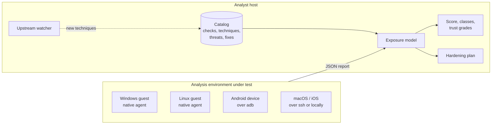

<div class="pd-hero" markdown>


# PERDEDOR

Sandbox-evasion self-test for Windows, Linux, Android, macOS and iOS. Finds every tell evasive
malware could use to notice your sandbox, scores what it costs you, and tells you what to fix first.

[Get started](#quick-start){ .md-button .md-button--primary }
[Source on GitHub](https://github.com/Chimera-Co/perdedor){ .md-button }
</div>

<div class="pd-stats">
  <div><b>1,009</b><span>checks</span></div>
  <div><b>5</b><span>platforms</span></div>
  <div><b>131</b><span>techniques</span></div>
  <div><b>91</b><span>malware families mapped</span></div>
  <div><b>30</b><span>upstream projects watched</span></div>
</div>

## Why

Malware that notices it is being analysed stops, sleeps or behaves. Over 40 % of Windows samples
collected in 2020 checked for that before doing anything
([Maffia et al.](https://arxiv.org/abs/2112.11289)). A sandbox that a sample can recognise produces
a clean report for a dangerous file.

Perdedor runs the same checks malware runs, against your analysis environment, and answers three
questions:

1. **What would malware notice here?** Every finding comes with the evidence behind it.
2. **How much does it cost?** The exposure score is the share of known evasive malware expected to
   run normally, broken down by class, with an interval and a trust grade.
3. **What do I fix first?** The hardening plan orders the fixes by score gained per unit of effort,
   and says at which layer each one lives.

## How it works



| Platform | Checks | How it runs |
|---|---|---|
| Windows (x64, x86) | 432 | One static C++ executable inside the guest. No PowerShell, .NET or runtime. |
| Linux x86-64 | 191 | One static C++ executable inside the guest. |
| Android | 197 | Driven from the analyst host over adb. Nothing installed on the device. |
| macOS | 116 | Locally, or from the analyst host over ssh. |
| iOS | 73 | Over ssh (jailbroken or Corellium device) or against the Simulator. |

## Quick start

Get the agents from the [latest release](https://github.com/Chimera-Co/perdedor/releases), or build
them with `make -C native`.

=== "Windows guest"

    ```bat
    perdedor-windows-x64.exe --profile standard -o report.json
    ```

=== "Linux guest"

    ```bash
    ./perdedor-linux-x86_64 --profile standard -o report.json
    ```

=== "Android, macOS, iOS"

    ```bash
    perdedor test android -s emulator-5554
    perdedor test macos -- --ssh analyst@mac-vm
    perdedor test ios -- --simulator booted
    ```

Then, on the analyst host:

```bash
pip install perdedor-2.0.1-py3-none-any.whl
perdedor score report.json     # exposure score with per-class detail and trust grades
perdedor plan report.json      # fixes ordered by score gain per unit of effort
```

Pick what runs with `--profile quick|standard|deep`, `--only` and `--skip` (id globs or `class:`,
`technique:`, `cost:`, `tag:` selectors), `--param key=value` and `--no-network`. The same options
work in every agent and in the CHIMERA console.

## Where to go next

<div class="grid cards" markdown>

- **[Scoring](SCORING.md)**: the exposure model, how it was chosen in a scoring lab, and how to read
  a result.
- **[Threats](THREATS.md)**: which malware families, tools and actors check what, with sources.
- **[Check coverage](CHECK_COVERAGE.md)**: every al-khaser, Pafish, VMAware and mobile-suite technique,
  covered or with the reason it is not.
- **[Landscape](LANDSCAPE.md)**: other tools, research papers and patents, and how Perdedor compares.
- **[Architecture](ARCHITECTURE.md)**: components, data model and how a scan runs.
- **[Staying current](UPSTREAM.md)**: the weekly upstream watcher.

</div>
